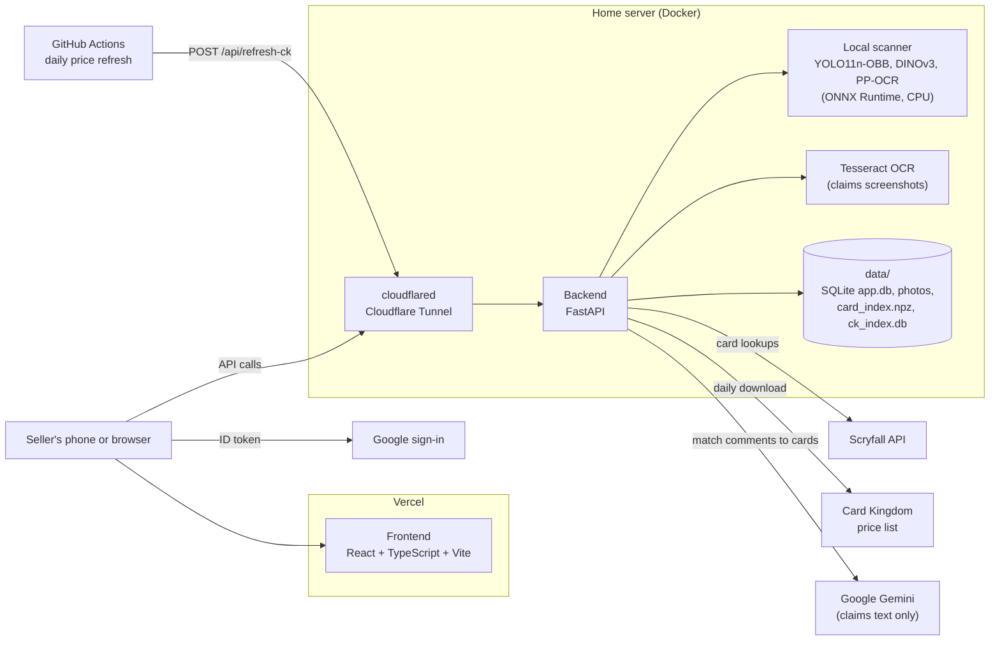
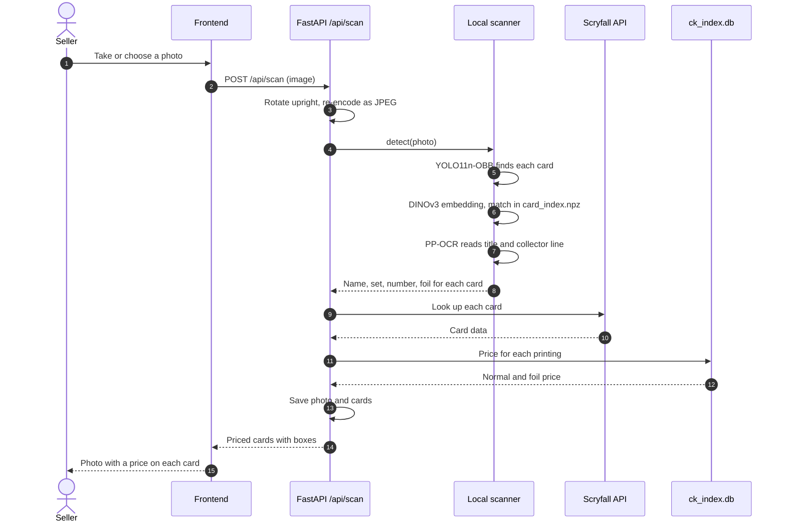

# Pasar Malam MTG

Pasar Malam MTG prices Magic: The Gathering cards from a photo. It also lets a seller post the cards and turn the Facebook comments into orders. It is for sellers at Malaysian night markets.

The live app is at [mtg.haziqhilmi.com](https://mtg.haziqhilmi.com).

## What the app does

- **Scan.** Take a photo of cards on a table. The backend finds each card, names the exact printing, and prices it from Card Kingdom.
- **Post.** Put the priced cards in a post. The backend can draw the prices on the photo for Facebook.
- **Claims.** Bring in screenshots of the Facebook comment thread. The app reads them and makes draft orders for the seller to confirm.
- **Orders.** Track each order and its payment.

## Architecture

The frontend runs on Vercel. The backend runs in Docker on a home server, and a Cloudflare Tunnel makes it public at `api.haziqhilmi.com`. On the live site, the browser calls that address directly. Vercel previews and the dev server use the same-site `/api` route, and Vercel sends it on to the backend (`frontend/src/api/http.ts`, `frontend/vercel.json`).

## How a scan works

A scan uses no cloud model. The backend reads `SCANNER_BACKEND` once at startup (`backend/app/services/scans.py`). Production sets it to `local`, so every scan runs on the home server CPU and costs no credit.

1. The detector (YOLO11n-OBB) finds each card as a rotated box.
2. The backend makes each card flat and upright, and embeds it with DINOv3 ViT-S/16.
3. The embedding is compared with `card_index.npz`. This index holds one embedding for each Scryfall printing (about 113,000).
4. PP-OCR reads the title bar. If the title is a real card name, it overrules a look-alike match.
5. PP-OCR reads the collector line (set code and number). The set and number choose the exact printing, and the star or dot shows a foil.
6. Scryfall gives the card data, and the local Card Kingdom price list gives the normal and foil prices.

`backend/app/services/card_scanner.py` has the full pipeline. The backend README section [Local scanner](backend/README.md#local-scanner) tells how to make the model files and the index.

If `SCANNER_BACKEND` is not `local`, the backend uses Gemini to find and name the cards (`backend/app/services/gemini_scanner.py`). This is the default in the code because it needs only an API key. Production does not use it, and the local scanner never falls back to it.

## Where Gemini runs

Production calls Gemini in one place: the claims step. Tesseract reads the text from the comment screenshots, and image matching finds which of the seller's photos a screenshot shows. Then Gemini gets the text only and matches each comment to the cards on sale (`backend/app/services/claims.py`). Each claims parse costs one credit. A signed-in user gets 50 credits in each 30-day window.

## Stack

| Part | Technology |
| --- | --- |
| Frontend | React 18, TypeScript, Vite, English and Malay text |
| Backend | Python 3.12, FastAPI, SQLAlchemy 2.0 (async), Alembic, SQLite |
| Card scanner | ONNX Runtime on CPU: YOLO11n-OBB detector, DINOv3 ViT-S/16 embedder, PP-OCR through RapidOCR |
| Claims | Tesseract OCR, Gemini (`google-genai`) |
| Sign-in | Google sign-in, then the backend's own JWT |
| Alerts | Telegram bot for bug reports |

## Data sources

- **Scryfall.** The backend looks up each scanned card on the Scryfall API. The card index is built from the Scryfall `default_cards` bulk data and card images (`backend/scripts/build_embedding_index.py`).
- **Card Kingdom.** The backend downloads the Card Kingdom price list and keeps it in `ck_index.db`. A GitHub Actions workflow (`.github/workflows/ck-refresh.yml`) asks the backend to do this every day at 02:00 UTC.
- **Google Gemini.** Used only to match claims comments to cards in production.

## Where each part runs

| Part | Where | How it updates |
| --- | --- | --- |
| Frontend | Vercel, root directory `frontend` | Vercel builds each push. A push to `main` goes to production. |
| Backend | Docker on a home server | A systemd timer runs `backend/deploy.sh` every 5 minutes. |
| Public API address | Cloudflare Tunnel to `api.haziqhilmi.com` | Not part of a deploy. |
| Data | `backend/data/`, mounted into the container | Not part of a deploy. `backend/deploy/backup.sh` and `mtg-backup.timer` make backups. |

### How a backend deploy works

A push to `main` deploys the backend. The deploy has these steps:

1. The `mtg-deploy.timer` unit starts `backend/deploy.sh` every 5 minutes.
2. The script fetches `origin/main`. If nothing is new, it stops.
3. If the change touches server setup (`docker-compose.yml`, `Dockerfile`, `deploy/`, or a `requirements*.txt` file), the script holds the deploy. An operator runs it again with `DEPLOY_INFRA=1` after a review.
4. Otherwise, the script fast-forwards the checkout and runs `docker compose up -d --build`.

`backend/DEPLOY_HOMESERVER.md` has the full server setup.

## Repository layout

- [`backend/`](backend/README.md) has the FastAPI app, the scanner, the migrations, and the deploy scripts.
- [`frontend/`](frontend/) has the React app.

[Privacy policy](frontend/PRIVACY.md) · [MIT licence](LICENSE)
